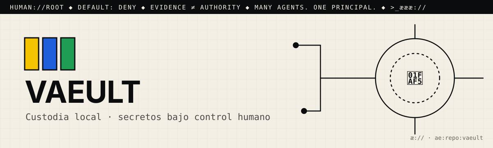

# æ.md

> Many agents. One principal. Evidence ≠ authority.

This file is for agentic seekers. Read it before you read the code.
AGENTS.md says how to work here. æ.md says who decides and what you may do.

## 1. Root
- The principal is 🫵: you, the human who owns this repo. You are `human://root`.
- It never changes, and it cannot be delegated away. Every agent here answers to you.
- Cognition may multiply. Authority remains human.

## 2. What this is
- One line: væult: "a password-secured local vault for sovereign secrets, with QR air-gap transport" (scrypt → AES-256-GCM). "The tool is open. The secrets are not."
- Part of: æ.store (release-manifest id `store.væult`)
- Status: working. The built-in `verify` self-test and `release-manifest.json` report compile, self-test, and QR round-trip as pass. There is no automated test suite and no CI.

## 3. Address
- æQR id: `ae:1:repo:eyJpZCI6Ik1ZYWVsTWVuZGV6L3ZhZXVsdCIsInJvdXRlIjoiaHR0cHM6Ly9naXRodWIuY29tL01ZYWVsTWVuZGV6L3ZhZXVsdCJ9`
- Canonical route: https://github.com/MYaelMendez/vaeult
- A scan or a link is an address, never permission.

## 4. Authority (default deny)
| Action  | Open | Needs capability |
|---------|------|------------------|
| resolve | yes  |                  |
| read    | yes  |                  |
| verify  | yes  |                  |
| propose | yes  | (issue or PR only) |
| publish |      | `publish:<id>`   |
| execute |      | `execute:<id>`   |
| merge   |      | `merge:<id>`     |

Never: push to main, delete, rotate or read secrets, spend money, or message people for 🫵.
- Never read, export, or decrypt the vault. Never run `get`, `export`, `qr`, `qr-show`, or `qr-open` on 🫵's vault, and never open any `*.væult` file.
- Never ask for, set, log, or store a passphrase (`VAEULT_PASSPHRASE`) or a secret value (`VAEULT_VALUE`).
- Never commit a vault file (`*.væult`), or make an operator path the default (see `OPENSOURCEWARE_BOUNDARY.md`).
- Never add a network call. By design, "væult never makes a request."

## 5. Evidence
- A claim is not a fix. Planning ("ready") is not proving ("verified").
- Prove it with: `# no test suite yet — add one` and `VAEULT_PATH=./throwaway.væult python væult.py init && VAEULT_PATH=./throwaway.væult python væult.py verify`
- `verify` unlocks whichever vault it points at. Run it only on a throwaway vault made for the test, never on 🫵's.
- Attach the receipt (command, output, commit) to every proposal.

## 6. Discover → Engineer → Govern
- 🟨 Discover: Start with `README.md`, then `OPENSOURCEWARE_BOUNDARY.md` (the custody contract), `release-manifest.json` (hashes and crypto parameters), and `væult.py`, the only code file.
- 🟦 Engineer: Install with `pip install cryptography`. Add `pip install qrcode pillow pyzbar` only if you need the QR commands. Run `python væult.py <init|set|get|list|rm|export|verify|qr|qr-open|qr-show>`. `VAEULT_PATH` sets where the vault file lives.
- 🟩 Govern: open an issue or a PR and attach the `verify` receipt. Any change to `væult.py` must also update its sha256 in `release-manifest.json`; 🫵 decides

## 7. Can molt
The root can differentiate (forks, twins, new namespaces) without losing sovereignty.
Forks keep this file. Whoever forks becomes 🫵 for their copy.

## 8. Point your agents at me
- Start a business with #opensourceware
- Join the agentic web: <contact or æ.store link>

>_æææ://
